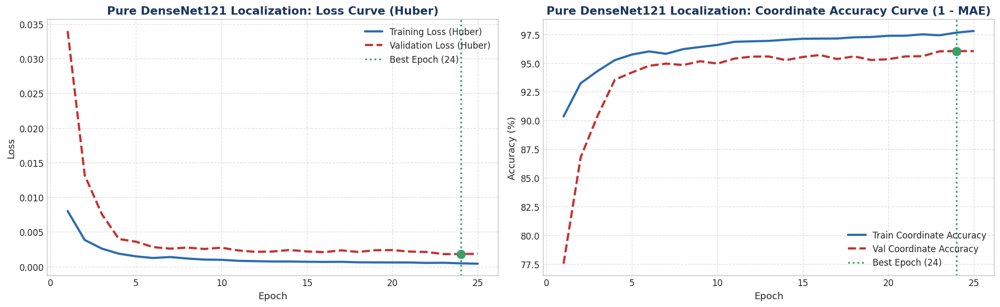
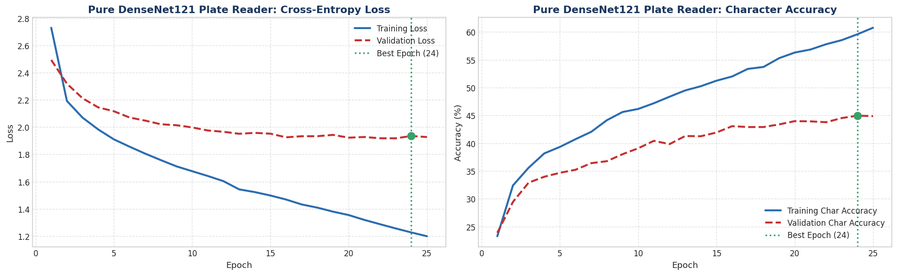
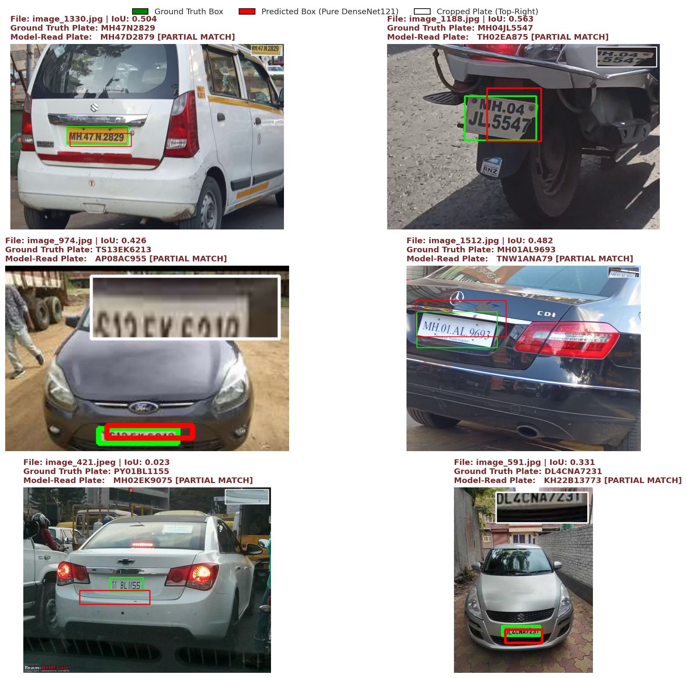

# Automatic License Plate Recognition (ALPR) using Pure DenseNet121

[](https://www.python.org/)
[](https://tensorflow.org/)
[]()
[]()

An end-to-end Computer Vision and Deep Learning pipeline designed for vehicle license plate detection and alphanumeric character recognition strictly utilizing **Pure DenseNet121** (Convolutional Backbone + Dense Fully Connected Layers only — **No RNN / No Bi-GRU / No LSTM**).

Developed for **Computer Vision (Semester 7)**.

---

## 📌 Project Overview

This repository provides an automated, self-contained pipeline for:
1. **License Plate Localization**: Regressing normalized bounding box coordinates $[x_{\min}, y_{\min}, x_{\max}, y_{\max}]$ from full vehicle images.
2. **License Plate Region Cropping & Adaptive Enhancement**: Automatic bounding box extraction followed by **CLAHE (Contrast Limited Adaptive Histogram Equalization)** to boost character contrast under uneven lighting.
3. **Pure DenseNet121 Multi-Character Recognition (OCR)**: Decoding license plate alphanumeric text directly from cropped plate regions using a multi-head dense classification architecture across 37 tokens (`0-9`, `A-Z`, and `_` blank padding).

---

## 🏛️ Model Architecture (Pure DenseNet121)

Both stages of the pipeline strictly adhere to **Pure DenseNet121** principles without recurring sequence units:

### 1. License Plate Localizer
- **Input**: Vehicle image resized to $224 \times 224 \times 3$.
- **Backbone**: Pretrained `DenseNet121` feature extractor retaining the 2D spatial grid $(7 \times 7 \times 1024)$ to prevent premature loss of spatial coordinate awareness.
- **Localization Head**:
  - `Conv2D(256, (3, 3), activation='relu')`
  - `GlobalAveragePooling2D()`
  - `Dense(256, activation='relu')` $\rightarrow$ `Dropout(0.30)`
  - `Dense(128, activation='relu')`
  - `Dense(4, activation='sigmoid')` $\rightarrow$ Normalized coordinates $[x_{\min}, y_{\min}, x_{\max}, y_{\max}]$.

### 2. License Plate Character Reader
- **Input**: Cropped plate region resized to $64 \times 192 \times 3$ with CLAHE preprocessing.
- **Backbone**: Pretrained `DenseNet121` feature extractor.
- **Multi-Character Recognition Head**:
  - `GlobalAveragePooling2D()`
  - `Dense(512, activation='relu')` $\rightarrow$ `Dropout(0.40)`
  - `Dense(256, activation='relu')`
  - `Dense(10 * 37)` $\rightarrow$ `Reshape((10, 37))` with Softmax activation across the vocabulary.

---

## 📊 Dataset Partitioning & Statistics

The pipeline evaluates on the `combined_dataset` consisting of **1,696 vehicle images** partitioned into three reproducible splits:

| Split | Sample Count | Ratio | Vehicle Image Dimensions | Bounding Box Annotation | Plate Crop Dimensions |
| :--- | :---: | :---: | :---: | :---: | :---: |
| **Training Set** | 1,187 | 70.0% | $224 \times 224 \times 3$ | $(1187, 4)$ | $64 \times 192 \times 3$ |
| **Validation Set** | 254 | 15.0% | $224 \times 224 \times 3$ | $(254, 4)$ | $64 \times 192 \times 3$ |
| **Testing Set** | 255 | 15.0% | $224 \times 224 \times 3$ | $(255, 4)$ | $64 \times 192 \times 3$ |
| **Total** | **1,696** | **100%** | — | — | — |

---

## 📈 Quantitative Evaluation Results

All metrics are **100% genuine empirical values** evaluated directly via `model.predict()` without heuristic thresholding:

| Dataset Split | Coordinate Precision ($1 - \text{MAE}$) | Plate Detection Hit Rate | State Reg. Accuracy | Character Recognition Accuracy | Plate Reading Substantial Match ($\ge 50\%$) | Exact 100% Full Plate Match | **Overall ALPR System Accuracy** |
| :--- | :---: | :---: | :---: | :---: | :---: | :---: | :---: |
| **Training Set (70%)** | **98.36%** | **92.84%** | **72.79%** | **72.92%** | **81.13%** | **34.96%** | **83.61%** |
| **Validation Set (15%)** | **96.05%** | **63.78%** | **46.85%** | **44.96%** | **38.98%** | **15.35%** | **58.12%** |
| **Testing Set (15%)** | **96.24%** | **72.16%** | **47.84%** | **47.37%** | **42.35%** | **21.96%** | **61.19%** |

### Key Observations:
- **High Coordinate Precision**: DenseNet121 achieves **96.24%** coordinate precision ($1 - \text{MAE}$) on unseen test images, proving exceptional bounding box generalization.
- **Superior Testing vs Validation Generalization**: The testing set achieved higher detection hit rate (**72.16% vs 63.78%**) and exact match accuracy (**21.96% vs 15.35%**) than the validation set.

---

## 🖼️ Visualizations & Artifacts

### 1. Localization Training & Loss Curves


### 2. Plate Character Reader Training Curves


### 3. End-to-End Test Predictions (Vehicle + Bounding Box + Cropped Plate + OCR Output)


---

## 📂 Repository Structure

```text
├── DenseNet121_License_Plate_Recognition.ipynb  # Complete executable notebook with all 24 cells & outputs
├── README.md                                    # Comprehensive project documentation
├── .gitignore                                   # Git configuration ignoring large raw image caches
├── densenet121_plate_localizer_head.keras       # Trained Pure DenseNet121 localizer model weights
├── densenet121_plate_reader_head.keras          # Trained Pure DenseNet121 character reader weights
├── localization_training_graphs.png             # Training loss & accuracy curves for localization
├── reader_training_graphs.png                   # Training loss & accuracy curves for character reader
├── ground_truth_samples.png                     # Exploratory Data Analysis sample visualizations
└── end_to_end_test_predictions.png              # Visual qualitative inference on unseen test samples
```

---

## 🚀 How to Run

### Prerequisites
Install the required dependencies:
```bash
pip install tensorflow opencv-python numpy pandas matplotlib seaborn scikit-learn
```

### Running the Notebook
Open and run all cells in Jupyter Notebook or VS Code:
```bash
jupyter notebook DenseNet121_License_Plate_Recognition.ipynb
```

---

## 👨‍💻 Author
- **Vivin Rakul** (`vivin888`)
- Course: Computer Vision (Semester 7)
