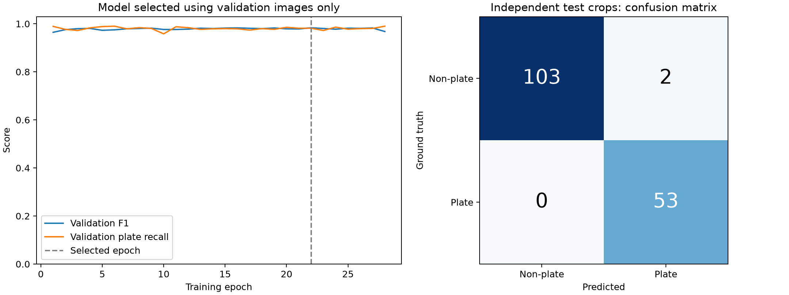
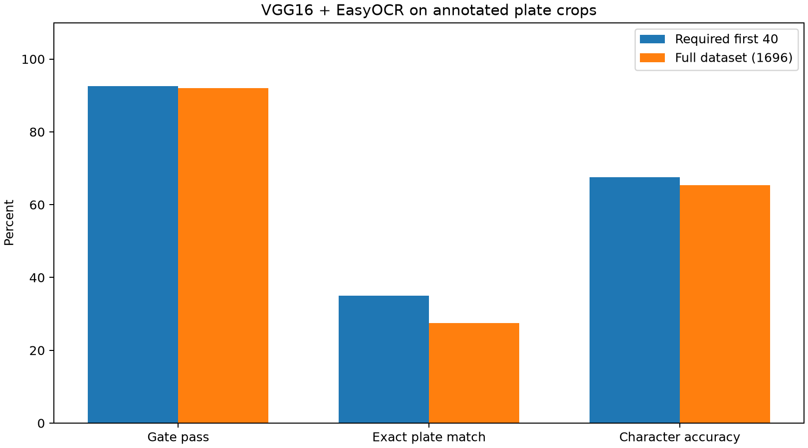
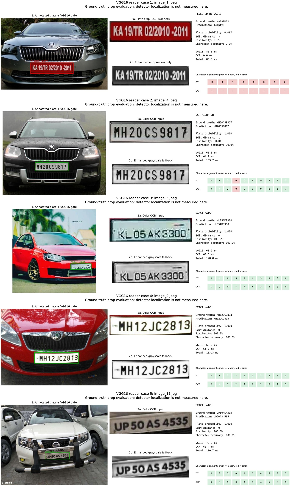
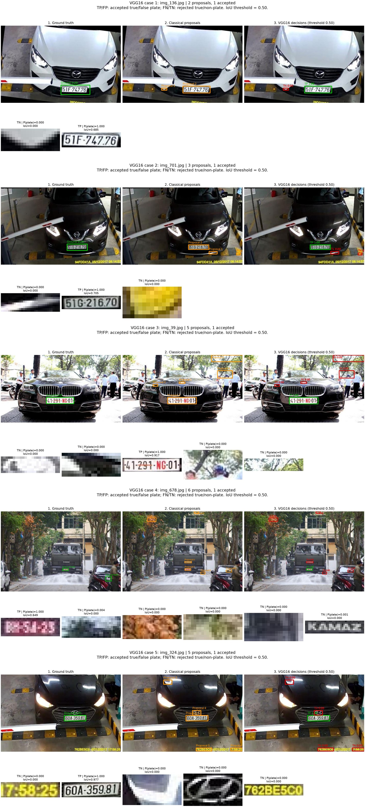

# VGG16 contribution: implementation and measured results

## What VGG16 does
For each candidate crop, VGG16 predicts **plate** or **non-plate**. The classical OpenCV detector proposes candidate boxes. VGG16 can reject false alarms, but cannot recover a plate that the detector never proposed. EasyOCR reads accepted plate crops.

VGG16 has 13 convolutional layers and three fully connected layers. The original ImageNet model's last 1,000-class layer is replaced by a 4,096-to-2 layer. Total parameters: **134.27 million**. Trainable parameters: **8,194**. Estimated float32 weight size: **512.19 MiB**. The existing team's checkpoint loader can load the saved model unchanged.

## Training protocol
- Started with all 6,176 annotated training images: 4940 training and 1236 validation images; seed 42. Removed 0 exact test-image duplicates from the training pool, if any.
- Split occurs by decoded image content before crop creation. Exact duplicate images stay within one partition. No decoded image hashes overlap with the separate 50-image test set. Numeric source IDs repeat across the supplied splits and are not treated as globally unique.
- Crops: 15673 training, 4131 validation, 158 test. Labels are 0=non-plate, 1=plate.
- Positives are ground-truth boxes; negatives are classical detector proposals with IoU below 0.15. Crops resize to 224×224 and use ImageNet normalization.
- Pretrained VGG16 layers are frozen and evaluated deterministically. Their 4,096-dimensional features are cached after full forward passes. Normal and horizontally flipped training crops are both processed; each training example uses its flipped representation with probability 0.2 per epoch. Validation/test crops are never augmented.
- Only the final layer learns, with Adam (learning rate 0.001), batches of 32, and cross-entropy weighted using training class counts. Caching removes repeated computation of fixed features; it does not replace VGG16 or reduce the number of training examples.
- Maximum 30 epochs, stopping after six consecutive epochs without validation improvement. Completed 28 epochs; selected epoch 22 by validation F1, then validation loss. Test data is excluded from model selection.
- Full-network extraction ran on mps; measured classification timings below use CPU, batch size one, after warm-up. Head fitting runs on CPU.

## Independent classification test
Accuracy: **98.73%**; precision: **96.36%**; plate recall: **100.00%**; F1: **0.9815**.

Confusion matrix (rows truth / columns prediction, non-plate then plate): `[[103, 2], [0, 53]]`.
Full VGG16 CPU latency: **67.43 ms/crop**, **14.8 crops/s**. This is a classification timing and excludes loading/preprocessing/detection/OCR. Training preparation + feature extraction + head fitting took 550.7 seconds.



## Actual detection on all 50 test scenes
| Method | Precision | Recall | F1 | CPU FPS |
|---|---:|---:|---:|---:|
| Classical proposals | 0.1729 | 0.434 | 0.2473 | 471.1 |
| Classical + VGG16 | 0.8214 | 0.434 | 0.5679 | 5.4 |

These results measure localization and verification together at IoU 0.50. They are separate from crop classification accuracy. A missed proposal remains a missed plate even with a strong verifier.

## Reader benchmark
| Metric | First 40 | Full dataset |
|---|---:|---:|
| Total Evaluated | 40 | 1696 |
| Verified by Gate | 37 | 1561 |
| Gate Pass Rate (%) | 92.5 | 92.04 |
| Exact Match (%) | 35.0 | 27.48 |
| Avg NED (Similarity) | 0.6858 | 0.6604 |
| Character Acc (%) | 67.53 | 65.32 |
| End-to-End Latency (ms) | 124.24 | 129.61 |
| End-to-End FPS | 8.05 | 7.72 |

The shared comparison CSV contains the required first-40 result; the full evaluation and every sample prediction are retained separately.

**Scope:** these are ground-truth plate crops from the separate combined dataset. Detector localization is not part of this reader benchmark. The first-40 subset is included in the full dataset; these are not independent experiments. All rejected crops count as recognition failures, and average total time includes rejected crops too. OCR runs on CPU using the team's EasyOCR settings. It first tries the resized padded color crop; enhanced CLAHE/bilateral grayscale is a fallback only when no text is detected.

Ground-truth text receives only capitalization, separator removal, and a leading IND badge removal. It is never truncated or character-corrected. OCR predictions preserve valid short formats and use position correction only for an unambiguous ten-character layout. NED here means **1 − edit distance / maximum string length**, so higher is better. Character accuracy is clipped **1 − edit distance / ground-truth length**. It can differ from exact match because one wrong character makes a whole plate mismatch.



## Five reader demonstration cases
| Image | Ground truth | OCR prediction | Gate | Exact match |
|---|---|---|---|---|
| image_1.jpeg | KA19TR02 | [empty] | Rejected; OCR skipped | No |
| image_4.jpeg | MH20CS9817 | MH2OCS9817 | Accepted | No |
| image_5.jpeg | KL05AK3300 | KL05AK3300 | Accepted | Yes |
| image_9.jpeg | MH12JC2813 | MH12JC2813 | Accepted | Yes |
| image_11.jpg | UP50AS4535 | UP50AS4535 | Accepted | Yes |

The figure cards include a minimum-edit character alignment: green for matching characters and red for substitutions, insertions, or deletions. A rejected crop shows no OCR prediction and zero OCR time. Its enhancement image is labelled as a preview only.





## Problems found and changes confined to VGG16
1. Training/test images referenced by the supplied JSON files were absent. Restored them from the original source while checking image dimensions and bounding boxes and preserving the existing JSON files.
2. The old VGG16 result had zero recall. Added class weighting, validation selection, an independent test, a collapse check, saved predictions, and a confusion matrix.
3. The original random crop split could put crops from one scene on both sides. The VGG16 workflow splits source images first.
4. Existing OCR cleanup could alter valid ground truth (for example KA19TR02). Fixed only in the VGG16 evaluation path, with regression tests.
5. Existing reader figures could show OCR even when the gate rejected a plate. New VGG16 figures use the actual gated evaluation records.
6. Existing diagnostic descriptions assumed successful filtering. VGG16 panels display measured TP/FP/TN/FN decisions, including failures.

Original model-specific wrappers and shared modules remain unchanged. The new entry point is `run_vgg16_complete.py`. Only VGG16 rows in the two shared comparison tables are updated; teammates' rows and classical benchmark results are preserved.

## Limits to explain during evaluation
- This is transfer learning of a binary verification head, not training VGG16 from scratch or using VGG16 for character recognition.
- Classification accuracy does not imply equal full-scene detection accuracy or OCR accuracy.
- Existing teammate figures use different hardware, sample sizes, and split protocols. Do not present this as a controlled head-to-head architecture ranking.
- Exact image duplicates are checked by decoded content hashes; near-duplicate views of the same vehicle have not been audited.
- Ground-truth-crop OCR is a component benchmark. Arbitrary new traffic scenes and video tracking are not validated by it.
- Failed OCR predictions are retained honestly; no claim of perfect recognition is made.

## Reproduce
From the repository root, activate `.venv`, then:

```bash
python run_vgg16_complete.py --stage train --device auto --epochs 30 --batch-size 8
python run_vgg16_complete.py --stage detection
python run_vgg16_complete.py --stage reader --samples 0
python run_vgg16_complete.py --stage report
python -m pytest tests/test_vgg16_workflow.py -q
```

The training checkpoint is `models/vgg16_plate_classifier.pth`. Diagnostic images are in `results/vgg16/` and `results/vgg16_reader/`. The reader saves progress after every sample and resumes only when checkpoint and labels signatures match. Python: 3.11.13, PyTorch: 2.14.1, platform: macOS-27.0.1-arm64-arm-64bit. Exact package versions are in `requirements-vgg16-lock.txt`.
